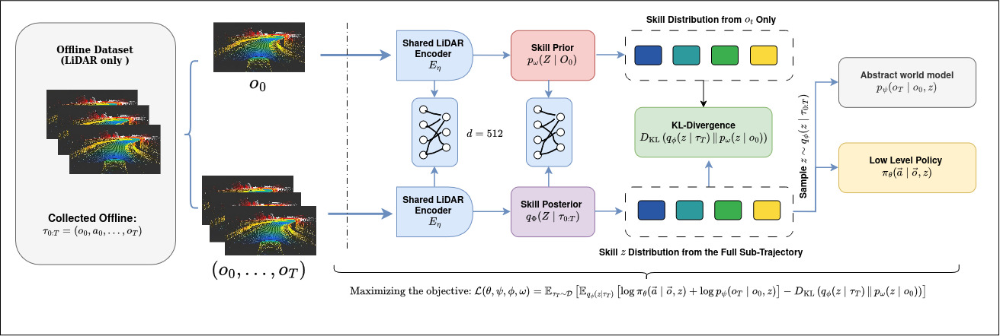

# Offline Abstract World Model for Autonomous Racing from LiDAR

**Aimen Boukhari**  
École Nationale Supérieure d’Informatique (ESI), Algiers, Algeria  
mn.boukhar@esi.dz

[Paper (coming soon)](#)

This repository adapts Online Planning with Offline Skill Models (OPOSM) to F1TENTH racing. The method learns from offline driving data and plans over latent driving skills using LiDAR observations, without explicit state estimates or further online training.

On unseen tracks, the approach achieved an **82% lap-completion rate**, compared with 67% for offline IQL and 42% for PPO-LSTM.

## Method

The world model predicts future LiDAR observations for candidate skill sequences. At inference, the Cross-Entropy Method (CEM) searches those sequences to maximize predicted driving reward.



## Installation

Run these commands from the project root. Install the F1TENTH Gym simulator, this project's Python dependencies, and the maps configured for data collection:

```bash
git clone https://github.com/f1tenth/f1tenth_gym.git
cd f1tenth_gym && pip install -e . && cd ..
pip install -r requirements.txt

git clone https://github.com/f1tenth/f1tenth_racetracks.git
mkdir -p maps
cp -r f1tenth_racetracks/Spielberg maps/Spielberg
cp -r f1tenth_racetracks/Austin maps/Austin
cp -r f1tenth_racetracks/MoscowRaceway maps/MoscowRaceway
```

The default collection maps are Spielberg, Austin, and MoscowRaceway. Copy any additional maps you plan to collect data from or evaluate into `maps/` in the same way. The `maps_root` and `collection.map_names` settings are in [`configs/default.yaml`](configs/default.yaml).

## Training

Generate offline driving data, then train the skill model and world model:

```bash
python scripts/generate_offline_data.py --config configs/default.yaml
python scripts/train.py --config configs/default.yaml
```

Data is written under `data/offline/`; checkpoints and normalizers are saved under `checkpoints/`. Adjust collection and training settings in `configs/default.yaml` before running.

## Evaluation

Evaluate a trained model on selected tracks:

```bash
python scripts/evaluate.py --config configs/default.yaml \
  --em_checkpoint checkpoints/oposm_final.pt \
  --normalizer_dir checkpoints \
  --eval_maps BrandsHatch Budapest Catalunya Hockenheim IMS Melbourne Montreal Monza
```

The evaluation script writes results under `outputs/`. Use `python scripts/evaluate.py --help` to see all options.

## Plan a lap

After training, run the CEM planner on a map. The map must be present under `maps/`, and the checkpoint and normalizers must be in `checkpoints/`:

```bash
python scripts/plan_lap.py --config configs/default.yaml \
  --checkpoint checkpoints/oposm_final.pt \
  --map Spielberg --render
```

`--render` opens the simulator window; omit it for headless planning. The trajectory and plot are saved under `outputs/plan_lap/` by default. Set `--out` to change the output directory.

## Self-contained notebooks

Run the method without cloning or using this repository's scripts with the [OPOSM method notebook](notebook/notebook.ipynb). For comparison baselines, see the [PPO, PPO-LSTM, and IQL notebook](notebook/rl_baselines.ipynb). Both notebooks include the code and setup needed for their respective workflows.

## Citation

```text
Paper coming soon.
```

## Acknowledgements

Built on [F1TENTH Gym](https://github.com/f1tenth/f1tenth_gym) and [F1TENTH racetracks](https://github.com/f1tenth/f1tenth_racetracks).

## License

This project is licensed under the MIT License.
